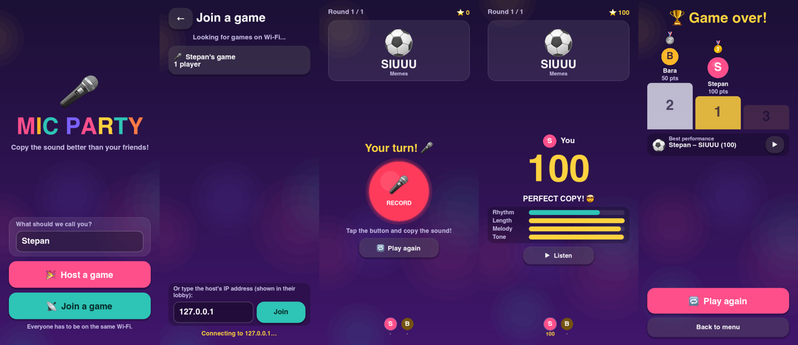

# 🎤 Mic Party – download

A party game for phones on the same Wi-Fi. A sound plays – memes, animals, cartoon effects – and
everyone takes turns copying it into their phone's microphone. The game scores how close you got
(rhythm, length, melody, tone). Most points wins.

## ⬇️ Download

**[Get the latest APK](https://github.com/ItzStepix/mic-party-apk/releases/latest)** (Android 7.0+)

1. Download `mic-party.apk` on your phone.
2. Open it and allow *Install unknown apps* for your browser / file manager when Android asks.
3. Allow microphone access on the first start.

## How to play

1. Everyone connects to **the same Wi-Fi**.
2. One player taps **Host a game**, the others tap **Join a game** – the game shows up automatically.
   If it doesn't, type the IP address shown in the host's lobby.
3. The host picks the number of rounds and the sound categories, then taps **Start game**.
4. Listen to the sound, wait for your turn, tap **RECORD** and copy it as well as you can!

**Doesn't connect?** Guest networks and some routers block devices from seeing each other
("client isolation"). Use your normal home Wi-Fi or a phone hotspot instead.

## Notes

- Made just for fun with [Godot](https://godotengine.org). No ads, no accounts, nothing leaves your Wi-Fi.
- The source code lives in a private repository.
- Meme clips belong to their original owners – see [CREDITS.md](CREDITS.md).
